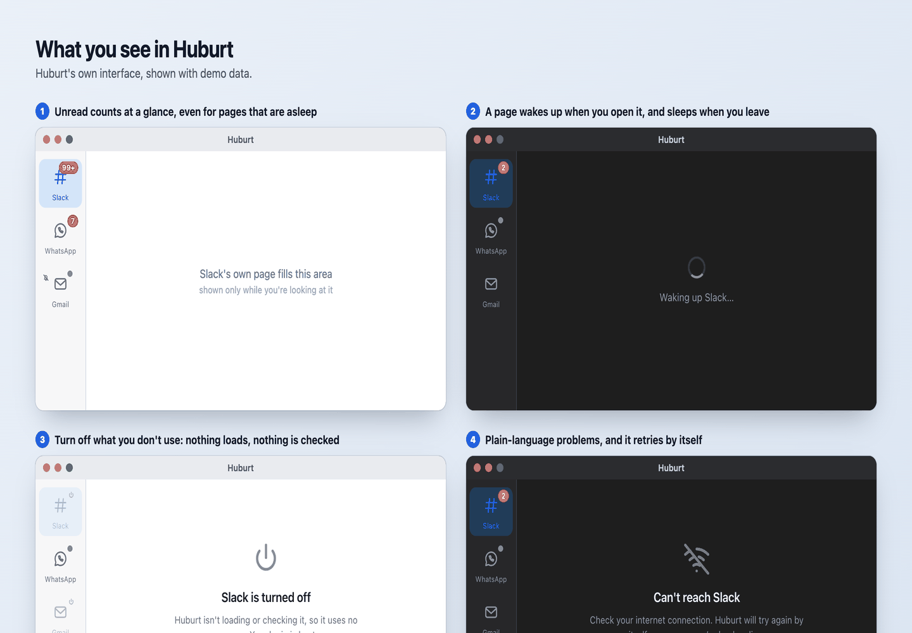
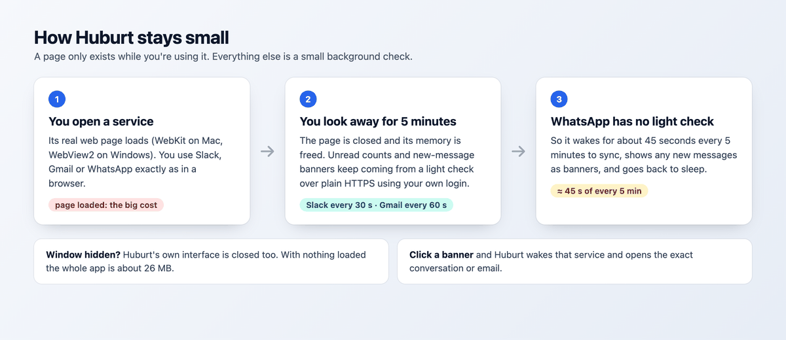
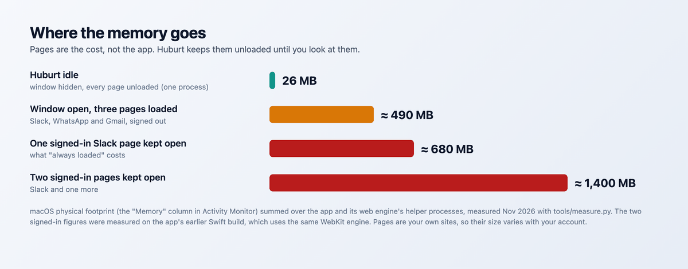

# Huburt: Slack, Gmail and WhatsApp in one lightweight window

[](https://github.com/ashalliants/huburt/actions/workflows/ci.yml)


**Huburt puts Slack, Gmail and WhatsApp in a single desktop window for macOS and Windows, and uses about 26 MB of memory when
you're not looking at it.** It is a lightweight alternative to all-in-one messaging apps like Ferdium, Rambox and Franz for
people who only need these three services and are tired of apps that eat gigabytes of RAM.



## Why Huburt

- **Tiny when idle.** A service's page is only loaded while you're using it. After you look away it is closed and its memory
  is freed, while a small background check keeps the unread count and new-message banners coming. With the window hidden and
  nothing loaded, the whole app is about **26 MB** (see [Memory](#memory)).
- **No bundled browser.** Huburt is built with [Tauri](https://tauri.app) (Rust). It uses the web engine already on your
  computer (WebKit on macOS, WebView2 on Windows) instead of shipping its own copy of Chromium like Electron apps do.
- **The real Slack, Gmail and WhatsApp Web.** You sign in once and use each site exactly as you would in a browser tab.
  Nothing is proxied, copied or sent anywhere else (see [Privacy](docs/privacy.md)).
- **Notifications that work like a chat app.** Banners for new Slack mentions and DMs have a **Reply** box and **Mark as
  Read** button, so you can answer without opening anything. Click a banner to jump to the exact conversation or email.
- **Built for people who are busy.** Menu bar or system tray icon with a red dot when something needs you, mute a service
  for an hour or until tomorrow morning, pause everything, and a short "good morning, here's what's waiting" summary.

## Features

| | |
|---|---|
| **Services** | Slack (all your workspaces), Gmail, WhatsApp Web. Each keeps its own separate login. |
| **Unread counts** | Per service, shown as badges in the sidebar and as a red dot on the menu bar / tray icon. Slack shows DMs and mentions, plus a quiet dot for unread channels. |
| **Notifications** | Native banners; Reply and Mark as Read for Slack messages; click to open the exact conversation or email. |
| **Memory** | Pages load on demand and unload after 5 minutes away. WhatsApp wakes for about 45 seconds every 5 minutes to sync. |
| **Dark mode** | Follows your system. Sites with no dark theme of their own (Gmail) are darkened, with images left alone. |
| **Slack "show as online"** | Optional: keep your Slack status active during work hours, or always. See the [FAQ](docs/FAQ.md#can-huburt-keep-my-slack-status-active). |
| **Quiet controls** | Mute one service for an hour or until 8am, pause all notifications, hide the red dot until something new arrives. |
| **Start at login** | Starts hidden in the menu bar / tray. |
| **Safe links** | Links in messages open in your default browser. Sign-in pages (Google, Microsoft, Okta, GitHub...) stay inside the app, but only while you're signing in. |
| **Keyboard** | Cmd/Ctrl + 1 to 3 switch service, Cmd/Ctrl + R reloads, Cmd/Ctrl + W hides to the tray. |

## Install

### Windows 10 and 11

Download `Huburt_x.y.z_x64-setup.exe` (or the `.msi`) from the [Releases](https://github.com/ashalliants/huburt/releases)
page. It installs for the current user, needs no admin rights, and uses the WebView2 runtime that Windows already includes.
The installers aren't code-signed yet, so Windows SmartScreen says "Windows protected your PC": choose **More info**, then
**Run anyway**.

> Windows support is new. It is built and tested by CI on a real Windows machine, but has had little hands-on use so far.
> Please [report anything odd](https://github.com/ashalliants/huburt/issues).

### macOS (Apple silicon)

1. Download `Huburt_x.y.z_macos-arm64.zip` from the [Releases](https://github.com/ashalliants/huburt/releases) page, unzip it,
   and drag **Huburt** to your Applications folder.
2. The first time, macOS will refuse to open it ("Apple could not verify..."), because the app isn't notarised by Apple yet.
   Approve it once, either way:
   - In Terminal: `xattr -dr com.apple.quarantine /Applications/Huburt.app`, then open it; or
   - open it, then go to **System Settings → Privacy & Security**, scroll down, and click **Open Anyway**.

macOS 14 (Sonoma) or newer is recommended. It has been tested on Apple silicon (M-series) only.
Each release is signed ad hoc, so macOS may ask you again to allow WhatsApp's encryption key after an update.

**Intel Mac, or if you'd rather build it yourself** (about five minutes):

```sh
# one-time: install Rust (https://rustup.rs) and the Tauri CLI
cargo install tauri-cli --version "^2" --locked

git clone https://github.com/ashalliants/huburt.git
cd huburt
./build.sh --install        # builds, signs and installs /Applications/Huburt.app
```

A build you make yourself is signed with a local certificate, which avoids the "could not verify" step. See
[Developing](docs/DEVELOPING.md#why-the-macos-build-has-two-parts) for the details.

### First run

Sign in to Slack, Gmail and WhatsApp (scan the QR code) once. Your logins stay on your computer, in the web engine's own
storage. Allow notifications when asked.

## How it works



More detail, including how Slack and Gmail unread counts are read without a page open, is in
[How it works](docs/DEVELOPING.md#how-it-works).

## Memory



Huburt's own footprint is small; the pages are the cost, and Huburt keeps them unloaded until you need them. The figures are
macOS physical footprint (the "Memory" column in Activity Monitor) summed over the app and its helper processes, measured with
[`tools/measure.py`](tools/measure.py). Windows numbers haven't been measured yet.

## Frequently asked questions

**Is there a lightweight alternative to Ferdium, Rambox or Franz?**
Yes, if you only need Slack, Gmail and WhatsApp: that is what Huburt does. It doesn't bundle Chromium and it unloads pages
you aren't using. If you need dozens of services, Ferdium or Rambox are better choices. See the
[comparison](docs/comparison.md).

**How do I use Slack, Gmail and WhatsApp in one app on a Mac or PC?**
Install Huburt, sign in to each once, and switch between them in the sidebar.

**How much RAM does it use?**
About 26 MB with the window hidden and every page unloaded. While you use a service, that service's page uses what it
normally does in a browser (a signed-in Slack page is several hundred MB), and it is freed again after 5 minutes away.

**Will I still get notifications for messages while a page is unloaded?**
Yes. Slack and Gmail are checked every 30 and 60 seconds over plain HTTPS using your own login, and WhatsApp wakes briefly
every 5 minutes. New messages become banners; WhatsApp can lag by up to 5 minutes.

**Is it private? Does it send my messages anywhere?**
No servers, no accounts, no telemetry. The pages talk directly to Slack, Google and WhatsApp, and the background checks do too.
Details: [Privacy](docs/privacy.md).

**Is it free and open source?**
Yes. See [LICENSE](LICENSE).

More answers (multiple accounts, adding other services, uninstalling, Slack status, Linux, and more) are in the
[FAQ](docs/FAQ.md).

## Limitations

- Three services, fixed: Slack, Gmail and WhatsApp. Adding another is a code change, not a setting
  (see [Contributing](CONTRIBUTING.md)).
- One Gmail account for unread counts and banners (you can still switch accounts inside Gmail), and one WhatsApp account.
- Slack and Gmail unread counts use the same web endpoints their own web apps use. They aren't official APIs, so a Slack or
  Google change can break them until Huburt is updated.
- Calls, huddles and screen sharing haven't been tested.
- The macOS download is Apple silicon only and isn't notarised (a one-time approval is needed); Windows installers aren't
  code-signed.
- Linux isn't supported.

## Project

- [Developing](docs/DEVELOPING.md): architecture, building, tests, logs and test switches, platform notes.
- [FAQ](docs/FAQ.md) · [Comparison with Ferdium, Rambox and Franz](docs/comparison.md) · [Privacy](docs/privacy.md)
- [Contributing](CONTRIBUTING.md) · [Security](SECURITY.md)

Slack, Gmail, WhatsApp and the other names used here belong to their owners. Huburt is an independent project and is not
affiliated with or endorsed by them.
